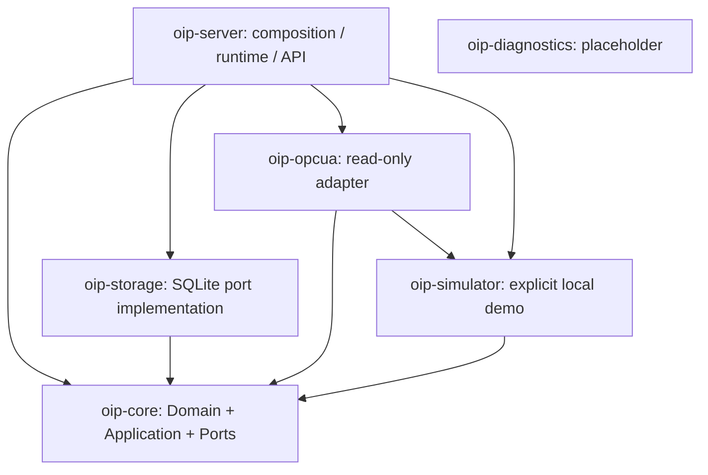

# OIP-004 — Modularer Core

Stand: 2026-11-04. Lokale Simulation und Entwicklung, keine Produktionsfreigabe.

## Ausgangslage und begründeter Änderungsbedarf

Vor Änderungen wurden alle acht Workspace-Manifeste, Rust-Quellen, CI-Dateien, ADR 0001/0002 und die Verifikationsberichte OIP-001 bis OIP-003 gelesen. Der gesamte vorhandene Repository-Inhalt war untracked; deshalb sind Git-Diffs keine belastbare Baseline. Eine Dateikopie liegt unter `target/oip004-baseline`, SHA-256-Werte unter `../evidence/oip004/baseline-hashes.json`. Bestehende Arbeit wurde erhalten, kein Commit oder Push durchgeführt.

Bereits vorhanden und wiederverwendet: typisierte IDs/Observation-Envelopes, Quality/Freshness/Provenienz, deterministischer Simulator, read-only OPC-UA-Vertrag, async-opcua mit Security-Profilen, unabhängige open62541-Interop-Tests, SQLite-Migration 1 mit idempotenter Aufnahme/Transaktionen, REST/SSE und fünf Flutter-Ansichten. Diese Eigenschaften sind keine Neuentwicklung von OIP-004. `oip-agent` und `oip-gateway` bleiben leere Einstiegspunkte; `oip-diagnostics` bleibt ein Platzhalter. Demo-Diagnosen sind explizite Fixtures, keine produktive Ursachenanalyse.

Nachgewiesene Probleme waren der einzelne Collector, nach Metrik statt Quelle getrennte letzte Werte, synchrone SQL-Arbeit innerhalb des gemeinsamen API-State-Locks, fehlende kontrollierte Task-Beendigung, verlorene Adapter-Queue-Ereignisse ohne persistierte Verlustmeldung und virtuelle Simulator-Zeitstempel-Watermarks über Reconnect hinweg. Es fehlten ein zentraler Lifecycle, unabhängige Quellen und ein überprüfbarer Neustartpfad. Ein weiterer Crate-Schnitt oder ein großer Workspace-Umbau war dafür nicht nötig.

## Modulverantwortlichkeiten und Abhängigkeiten

Es gibt keine zyklischen Workspace-Abhängigkeiten. `oip-core` benötigt im Produktcode nur serde und thiserror, weder Tokio noch SQLite, Axum, OPC UA oder Flutter. `application.rs` orchestriert Validierung, Ordnung, Persistenz, Checkpoints und Health. `application_contracts.rs` enthält den synchronen `CoreRepository`-Port und die typisierten Zustände. `oip-storage/src/application.rs` implementiert diesen Port. SQL bleibt vollständig im Storage-Adapter.

Im Server besitzen `config.rs` die validierte Konfiguration, `runtime.rs` unabhängige Quellen-Worker und den Lifecycle-Supervisor, `writer.rs` den einzigen Datenbankbesitzer, `state.rs` begrenzte Admission und Snapshot-Projektionen, `api.rs` den HTTP-Adapter. Die bestehende `collector.rs` delegiert an denselben Worker. Demo-Metadaten haben einen separaten kleinen Mutex; der fachliche State gehört ausschließlich dem Writer. `watch` veröffentlicht unveränderliche Kopien, Client-/Catalog-Maps verwenden explizite async RwLocks. Keine unsynchronisierte globale State-Sammlung.

## Adapterverträge

`CollectionAdapter::connect` liefert eine `CollectionSession` mit `next`, `close` und `buffered`. Alle Operationen sind typisierte fallible Futures. Ein neuer Protokolladapter implementiert diese Laufzeitverträge und liefert bestehende Domänenereignisse; der fachliche Application-Core muss dafür nicht geändert werden. Ein anderer Storage-Adapter implementiert `CoreRepository` einschließlich atomarem Event-plus-Checkpoint-Commit.

OIP-004 konfiguriert ausschließlich den vorhandenen lokalen OPC-UA-Simulator: Namespace 2, bekannte Metriktypen und 1.000 lesbare Bulk-Nodes. Keine generische Discovery oder Plugin-Runtime. Zwei Simulatorprozesse dürfen denselben ursprünglichen Simulations-Origin besitzen. Ihre logisch eingeschriebenen `DataSourceId`s und Endpoints unterscheiden sie; Seed, Szenario und Ursprung bleiben als Provenienz erhalten. Die Zuordnung erfolgt erst nach Prüfung des Adapterprofils. Endpoint-Bindings persistierter IDs sind unveränderlich; ein anderer Endpoint erfordert eine andere Registrierung oder eine spätere explizite Migration.

Jeder Worker verbindet und reconnectet unabhängig, fängt Adapter-Panics ab, persistiert quellbezogene Fehler und wartet vor erneutem Versuch eine Sekunde. Ein ausgefallener OPC-UA-Dienst belegt keine andere Adapter-Session. Hardware-Reachability wird aus einem OPC-UA-Fehler nicht abgeleitet: nach Verbindungsfehler steht sie ehrlich auf Unknown.

## Lifecycle und Shutdown

Initialisierung validiert Konfiguration, öffnet SQLite, prüft versionierte Checksummen/Migrationen, lädt registrierte Identitäten/Checkpoints/Ereignisse, eröffnet ein Run-Journal, startet Writer, Adapter und den Freshness-Ticker. Erst Komponentenbedingungen ergeben Ready oder Degraded. Ein Prozess mit gesunden Quellen kann bei einer anderen ausgefallenen Quelle Degraded und dennoch teilweise bereit sein.

- Initializing: Aufbau, keine Readiness.
- Ready: alle Quellen verbunden, erforderliche Werte gültig und frisch, Persistenz gesund.
- Degraded: mindestens eine Bedingung fehlt; `ready=true` nur bei gesunder Persistenz und wenigstens einer gesunden Quelle.
- Stopping: sofort keine Readiness, SSE beendet, keine neuen API-Node-/Demo-Aufträge.
- Stopped: Adapter beendet, zugelassene Ingestion abgearbeitet und Run-Abschluss persistiert.
- Failed: fehlgeschlagener Start, verlorener Writer oder nicht sauberer Abschluss.

SIGINT und SIGTERM koordinieren Cancellation. Adapterproduzenten werden gestoppt, ihre begrenzten Puffer abgerufen und bereits zugelassene Writer-Kommandos FIFO abgearbeitet. Eine Observation wird erst nach atomarem SQLite-Commit bestätigt/veröffentlicht. Laufende Transaktionen enden im Datenbankthread. Shutdown liefert `clean`, `uncommitted`, `adapter_failures` und `persistence_thread_joined`. Das konfigurierte Shutdown-Budget begrenzt das Warten; ein erzwungener Task-Abbruch oder nicht abgeschlossener Commit wird nicht als sauberer Datenabschluss bezeichnet. Drop ohne expliziten Shutdown markiert den Runtime-Verlust als Fehler und besitzt/stoppt seine Tasks.

Ein langsamer HTTP-Client kann den TCP-Write blockieren. Nach dem Daten-Drain erhält HTTP drei Sekunden zum Beenden; danach wird dieser HTTP-Task geschlossen und `http_forced_close=true` separat gemeldet. Das sagt nichts über Datenverlust im Core aus. Kein `process::exit` im Library-Code. Ein vom Betriebssystem dauerhaft blockierter Dateisystemzugriff lässt sich nicht sicher innerhalb Rusts töten; ein nicht gejointer Thread bleibt ausdrücklich ein fehlgeschlagener Shutdown.

## Ingestion, Zeit und Datenintegrität

Adapter → validiertes ObservationEnvelope → Application → atomarer Event-/Observation-/Checkpoint-Commit → Health/Snapshot/SSE. Schlüsseldimensionen sind Quelle, Entity und Metrik. Registrierung enthält Typen, Provenienz und erforderliche Metriken. Fehlende Good-Werte, unbekannte Typen, NaN/Infinity, ungültige Provenienz, unplausible Zeitbereiche und negative Gap-Dauern werden abgelehnt und als Fehler evidenziert. Explizite Bad-/Unknown-Werte bleiben fehlende Werte; sie werden niemals in Null umgewandelt. Explizite InvalidTimestamp-Evidenz darf gespeichert werden, wird aber kein aktueller Messwert.

Idempotenz verwendet weiterhin den vorhandenen persistierten Observation-Key; erneute lokale Receive-Zeit allein erzeugt keinen neuen Messpunkt. Out-of-order-Werte bleiben Historie, ersetzen innerhalb einer Session aber nicht den aktuellen Checkpoint. Eine neue tatsächliche Verbindung beginnt eine neue Watermark-Epoche, damit der neu gestartete deterministische Simulator mit zurückgesetzter virtueller Quellzeit wieder Daten liefern kann. Keine Exactly-once-Behauptung.

Freshness richtet sich pro Observation nach tatsächlicher Receive-Zeit, Verbindung und aktueller Session. Quell-Health fordert aktuelle gültige Temperatur und Druck; selten wechselnde boolesche/Textwerte und browsende Bulk-Lesezugriffe erzeugen keine künstliche Quell-Readiness. Negative lokale Zeitdifferenzen ergeben Unknown. Restore ist gesondert: Werte werden Stale, Reachability Unknown, `last_received_ms=null`, bis wirklich erneut beobachtet wurde. Recovery-Gaps beginnen beim letzten tatsächlichen Empfang. Bei rückwärts laufender Uhr wird eine explizite `clock_regression`-Meldung erzeugt statt einer erfundenen Gap-Dauer.

## Backpressure und Fehlerisolation

Der Writer besitzt genau eine bounded Tokio-mpsc-Queue (Standard 64, zulässig 1–4096). Async-Ingestion wartet bei voller Queue und meldet Backpressure-Zähler; `try_ingest` liefert einen sichtbaren Fehler. Bis zu 32 konfigurierte Worker besitzen jeweils den bereits vorhandenen begrenzten Adapterpuffer (1.024 Events) plus sechs Startwerte. Es gibt keine unbegrenzte Beobachtungsqueue und keinen zusätzlichen SSE-Clientpuffer. Die Application hält nur aktuelle Checkpoints und höchstens 100 Kontrollereignisse.

Bei SQLite-Sperre bleibt dasselbe Pending-Event erhalten und wird erneut versucht, ohne normales Laufzeitlimit. Die Queue begrenzt weiteren Speicherbedarf; API-Reads nutzen den letzten bestätigten Cache. Nach Datenbank-Recovery fließt die Aufnahme weiter. Anhaltende Überlast kann den begrenzten OPC-UA-Puffer füllen. Sein realer Drop-Zähler erzeugt `DataLoss` und persistierte Gap-Evidenz. Der genaue verlorene Sample-Zeitraum ist unbekannt: der Gap-Datensatz enthält einen ausdrücklich als solchen bezeichneten Zeitpunktmarker, keine erfundene Intervallmessung. Ein langsamer SSE-Client kann nur eigene Snapshot-Revisionen verpassen, niemals den Writer blockieren.

## Persistenz und Wiederanlauf

Migration 1 wurde nicht verändert. Migration 2 ergänzt `core_sources`, `core_latest` und `core_runs`; gültige Version-1-Datenbanken werden einschließlich alter Evidenz übernommen. Neue Checkpoints und die ursprünglichen Event-/Observation-Tabellen werden in derselben Transaktion geschrieben. Ein absichtlich scheiternder Checkpoint-Trigger beweist vollständiges Rollback und anschließende Recovery.

Der Runtime-Writer setzt den SQLite-Busy-Timeout auf 100 ms, damit Fehler/Shutdown diagnostizierbar bleiben. Ein Run beginnt persistent als running; ein sauberer Abschluss wird stopped, fehlerhafter Abschluss failed. Vorherige running-Runs werden beim Neustart interrupted. Restore lädt nur letzte Werte und begrenzte Kontrollereignisse, nicht sämtliche Historie in RAM. Historische SQL-Aggregation kann mit großer Datenbank teuer werden; Retention/Indizes für Langzeitbetrieb sind Folgearbeit.

Ein Prozess pro Datenbank ist die Betriebsannahme; es gibt noch keinen Multi-Prozess-Writer-Lease. Die RAM-Admission ist kein dauerhafter Spool. Ein SIGKILL kann unbestätigte In-flight-Daten verlieren; Run-Journal und erneute Verbindungs-/Recovery-Gaps machen die Unterbrechung sichtbar, garantieren aber keine Rekonstruktion jedes noch nicht bestätigten Samples. Ein bestätigtes Commit bleibt atomar. Der Akzeptanztest prüft SIGKILL während gesperrter Ingestion, Integrität und Wiederaufnahme; Stromausfall-/Hardware-Durability ist damit nicht getestet.

## API und Frontend-Kompatibilität

Alle APIs funktionieren ohne Flutter und ohne Webverzeichnis. `--no-web` liefert für `/` 404, während API und Health arbeiten. Normalbetrieb liefert ausschließlich registrierte Quellgeräte und echte eingegangene Observations; Fixtures existieren nur im expliziten `--demo`-Profil.

| Endpoint | Vertrag |
|---|---|
| GET `/api/v1/core/health` | CoreHealth; Queue-Auslastung im SSE-Snapshot |
| GET `/api/v1/sources` | getrennte Connection/Reachability/Service/Freshness/Validity pro Quelle |
| GET `/health/live` | Prozess/Core-Liveness, HTTP 200 oder 503 |
| GET `/health/ready` | komponentenbasierte teilweise Readiness, HTTP 200 oder 503 |
| GET `/api/v1/system/status` | bestehender OIP-003-SystemStatus, fehlende Host-Telemetrie null |
| GET `/api/v1/devices[/{id}]` | bestehende Device-/DeviceDetail-Struktur; weitere Quellen `source:M-01` |
| GET `/api/v1/metrics/current` | bestätigte aktuelle ObservationEnvelopes, echte Freshness |
| GET `/api/v1/events` | alte Felder plus sequenzierte Kontroll-Records mit Quelle/Provenienz |
| GET `/api/v1/opcua/nodes?source=...` | vorhandene paginierte Nodes, Quelle optional (primär als Default) |
| GET `/api/v1/stream` | bestehender Snapshot plus Core-/Source-/Queue-Zustände und Resync-Hinweis |

Fehler verwenden strukturierte `ok/code/message`-Antworten. REST-DTOs und Core-/Source-/Event-Verträge sind explizite Rust-Typen. Storage-Fehler veröffentlichen stabile redigierte Operation-Codes, keine Payloads oder Credentials.

SSE ist ein koaleszierender vollständiger Snapshot-Stream über watch mit ID `run_id:revision`. Er besitzt **kein** vollständiges Replay. `Last-Event-ID` berechtigt nicht zur Annahme lückenloser Event-Lieferung. Jede Verbindung erhält den aktuellen Gesamtzustand mit `resync_required=true`; `/events` nennt `replay_supported=false`. Clients synchronisieren Zustände über REST oder vollständige Snapshots. Die letzten 100 Kontrollereignisse sind keine vollständige Historien-API. Persistierte vollständige Evidenz bleibt in SQLite. OIP-003-Client versteht die unveränderten alten Felder; additive Felder stören ihn nicht. Die fünf Flutter-Ansichten, Packages, Designs und Animationen wurden nicht verändert.

## Observability und Security

Strukturierte JSON-Logs enthalten Source-ID, Run-ID als Korrelation, Lifecycle, Connect-/Fehlercodes und Shutdown-Ergebnisse. Runtime-Health zeigt echte Empfangszeiten, Reconnect-/Rejected-/Duplicate-/Out-of-order-/Drop-Zähler, Persistenzfehler und Queue-Auslastung. Zähler sind laufbezogen; persistierte Evidenz bleibt separat. Keine simulierte CPU/GPU-/Netzwerk-Health als Hostmessung.

`RUSTSEC-2023-0071` bleibt produktiver Blocker. Die bestehenden Advisory-Ausnahmen 2023-0089/2024-0449 bleiben ebenfalls offen. Loopback-Bind, lokale Simulationsendpoints, read-only OPC UA, keine Zertifikatsumgehung, keine produktive Remote-/VPN-Freigabe, keine Cloud oder externen Agenten. Das erfolgreiche cargo-deny-Gate mit unveränderten Ausnahmen ist keine Risikobehebung. Neue Abhängigkeit ist nur die bereits transitiv verwendete tracing-serde durch strukturierte JSON-Logs; keine neue Workspace-Crate oder Protokollintegration.

Exakte Start-/Testbefehle und Gates stehen in [OIP-004-Verifikation](../oip-004-verification.md).
