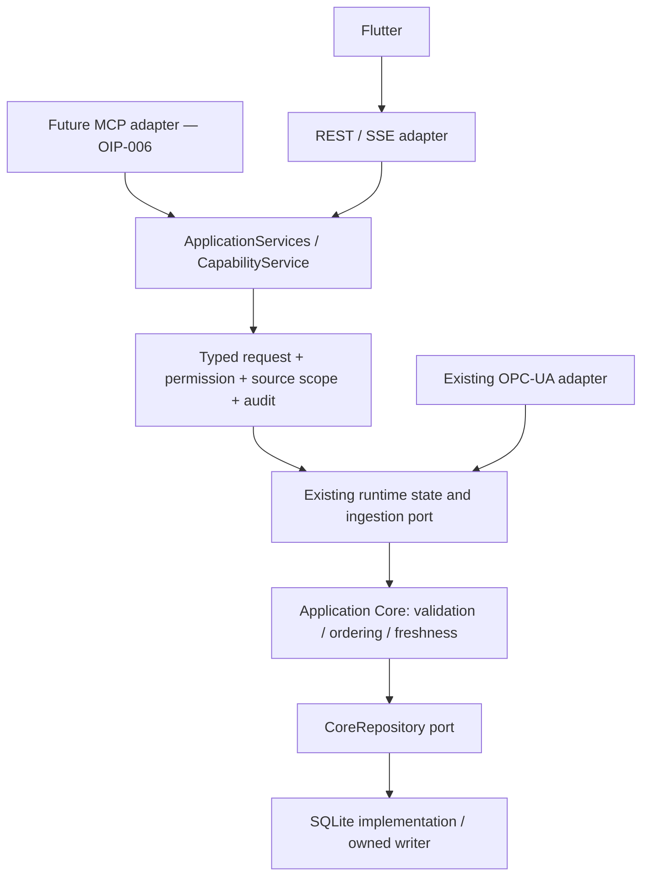

# OIP-005 — Canonical Integration & Agent-first Foundation

Stand 2026-11-04. **OIP IS AGENT-FIRST BY DESIGN.** Agent-first bedeutet einen typisierten, autorisierbaren Rust-Application-Core, der ohne Agent, Modellanbieter, MCP oder GUI funktionsfähig bleibt. OIP-005 implementiert keinen MCP-Server und keine produktive Remote-Administration.

## Kanonische Baseline und Integrationsautorität

Der führende Stand war der tatsächlich vorhandene OIP-004-Core im Repository, nicht die ältere Serverkopie der UI-Session. Branch `main`, HEAD unborn, 0 tracked und 284 nicht ignorierte untracked Dateien. `git diff` wäre hier keine vollständige Sicherung gewesen.

Externes, dateiweise verifiziertes Backup:

`/Users/benny/Documents/OIP-Handoffs/core-005-baseline-20261104T012210Z/project-baseline.tar.gz`

SHA-256: `56f79d98ad415d31eddbcb5f6a4f48e5e3e582540963f40ac03f0ebc0c9aa052`.

Daneben liegen `inventory.json`, `baseline.json`, `git-status.txt` und `sessions.json`. Alle 126.146 ignorierten Dateien wurden als Metadaten inventarisiert. Build-Ausgaben, installierte Abhängigkeiten, Runtime-Datenbanken, PKI, Secrets und ignorierte Logs sind ausdrücklich nicht im übertragbaren Source-Archiv. Die Originale wurden nicht gelöscht oder ersetzt. Es wurde kein Git-Commit als künstliche Basis angelegt. Der vollständige nicht ignorierte Projektbestand einschließlich Vendorcode, Fonts, Designreferenz und vorhandener Evidenz ist archiviert; Ignore-Regeln und vertrauliche lokale Dateien bleiben respektiert.

OIP-005-Core-Session `01a1a3b3-9469-7311-be9a-1218be181ebc` ist alleinige Integrationsautorität. Der Session-Audit liegt unter [sessions.json](../evidence/oip005/sessions.json). Er enthält IDs, Titel/Workstream, Arbeitsverzeichnis, bekannte Bearbeitungszeiten und verfügbaren Aktivstatus. Die UI-Zulieferung stammt aus `ses_e5c15927effeK5cDlqK9FuEkuE`, einer isolierten Snapshot-Kopie ohne Branch/Commit; weitere bekannte OIP-Sessions sind historische Analyse-/Review-Sessions. Der verfügbare lokale Session-Status meldete keine aktiven Konkurrenz-Tasks. Ein offenes Terminal mit ursprünglichem OIP-cwd ist kein Nachweis eines schreibenden Tasks. Zusätzlich wurden sämtliche Source-Hashes unmittelbar vor Anwendung gegen das externe Backup geprüft. Das ist eine beobachtete Integrationskontrolle, kein systemweiter Sperrmechanismus für fremde Programme.

## Handoff-Prüfung und kontrollierte Übernahme

Beide vom Operator genannten Ablagen wurden geprüft. Sowohl die temporäre als auch die dauerhafte Kopie haben den erwarteten Archivhash:

`2e657d4b9c28a6d8adc7aa55151a3fe5a2601e2fb01fc8894afb02fd2c91714a`.

Der vollständige Handoff-Bericht wurde gelesen. 126 Tar-Member wurden geprüft: nur reguläre Dateien/Verzeichnisse, keine Symlinks/Hardlinks/Special-Files, keine absoluten Pfade, Traversal- oder Backslash-Pfade, keine doppelten Member. Der vollständige Manifestbestand wurde gegen SHA-256 geprüft; der äußere und innere Bericht sind identisch. Das Archiv wurde ausschließlich in einen separaten Validierungsbereich beim externen Backup gelesen, niemals in den Repository-Root entpackt.

Der Reverse-Patch wurde auf einer zweiten isolierten Kopie der gelieferten Enddateien geprüft und angewandt. Alle rekonstruierten Altdateien stimmen bytegenau mit dem aktuellen Flutter-Stand überein; verfügbare OIP-004-Baseline-Hashes bestätigen zusätzlich die OIP-003-Herkunft. Alle 19 Deltas wurden als konfliktfrei beziehungsweise konfliktfrei neu klassifiziert und erst danach einzeln übernommen. Es gab keine bereits vorhandenen identischen Enddeltas, keine manuell zu lösenden Patchkonflikte und keine unerlaubte Rust-/CI-Änderung im Paket. Manifest, Klassifikationen und Alt-/Neuhashes stehen in [provenance.json](../evidence/oip005/provenance.json). Lieferanten-Evidenz liegt getrennt unter `docs/evidence/oip004-ui`; sie ist historisch und keine neue Core-Verifikation.

Die fünf Ansichten, Navigation, native macOS-Projektdateien, Packages und REST/SSE-Transport bleiben erhalten. Die neue Spectrum-Designrichtung wurde nicht umgesetzt; übernommen wurde ausschließlich das geprüfte OIP-004-UI-Delta.

## Kleine notwendige Architekturkorrektur

Der OIP-004-Ingestion-Core war bereits infrastrukturfrei. Es fehlte aber eine gemeinsame Application-Bediengrenze: Node-Auswahl/-Reads, Gerätedetail-Filterung, Eventprojektion und Szenariovalidierung waren direkt an Axum-Handler gebunden. Ein späterer MCP-Adapter hätte diese Regeln kopieren oder HTTP intern nachspielen müssen.

Daher wurden die vorhandenen read models ohne neue Crate nach `oip-core/src/service_contracts.rs` verschoben. `oip-server::contracts` re-exportiert die bestehenden Typnamen kompatibel. `QueueHealth` liegt ebenfalls im neutralen Vertrag. `CapabilityRequest`, `CapabilityOutput`, `CapabilityError`, Permissions, SourceScope, ExecutionContext, Audit-Port und Capability-Katalog liegen in `oip-core/src/capabilities.rs`. Der Core benötigt weiterhin nur serde und thiserror im Produktcode.

`oip-server/src/application_services.rs` implementiert den Port `CapabilityService`. Es übernimmt vorhandene Anwendungsabfragen und die ausschließlich lokale Simulationssteuerung. Es besitzt keine Axum-/Flutter-/MCP-Typen. Die konkrete Bindung an Runtime, SQLite-Writer und vorhandenen read-only OPC-UA-Adapter bleibt im Composition-Crate `oip-server`; sie wird nicht in die Domain verschoben. Diese logische Application-Schicht braucht keinen großen Workspace-Umbau. Der vorhandene generische `Application<R>` behält die alleinige fachliche Ingestion-Verarbeitung.

Die acht Workspace-Mitglieder und die interne Dependency-DAG bleiben unverändert und azyklisch. Keine neue Rust-Crate, kein Flutter-Package, keine MCP-Bibliothek, keine Modell-/Agentenanbindung. Der spätere MCP-Adapter verwendet dieselbe Serviceinstanz/Runtime und dieselben Source-Sessions; er startet keinen zweiten Collector und greift nicht direkt auf SQL oder Geräte zu.

## Autorisierung und nachvollziehbare Ausführung

Jeder externe fachliche Lesepfad hat einen realen Capability-Request, eine serialisierbare Ausgabe und eine Permission-Menge. Die Device-Detail-Capability benötigt auch TelemetryRead, da sie Messwerte zurückliefert. Der gesamte Snapshot verlangt alle enthaltenen Leseberechtigungen. Source-begrenzte Kontexte können keine globalen Aggregationen oder fremden Quellen lesen. Die Source einer Device-ID wird über die autoritative Zuordnung aufgelöst, nicht aus einer vom Agenten behaupteten Berechtigung.

Aktueller HTTP-Hostkontext: `local-development`, echte Run-/Aufruf-Korrelation, explizite Read-Permissions, SimulationControl ausschließlich beim expliziten Demo-Profil. Weder Header noch Toolbody dürfen Actor/Grants setzen. **Das ist keine produktive Benutzer-Authentifizierung.** Loopback und Same-Origin bleiben unverändert erforderlich. Tenant-Zuordnung, produktive Identitäten, Rollenverwaltung und Remote-Authentifizierung sind noch nicht implementiert.

Die einzige externe Mutation bleibt `simulation_scenario_set`. Ohne Featureprofil ist sie OperationNotSupported; ohne Grant oder mit fremdem Scope PermissionDenied. Ein meldbarer Auditfehler vor Wirkung verhindert die Aktion. Entscheidung und Ergebnis werden ohne Parameter-/Credential-Payloads protokolliert. Nur tatsächlich registrierte Source-IDs werden als Ziel geloggt; unbekannte vom Aufrufer gelieferte Zielstrings werden redigiert. Ein Abschluss-Auditfehler nach Wirkung wird explizit als unbestätigter Abschluss gemeldet. Der heutige Standard ist ein strukturierter lokaler Log; dauerhaftes, transaktionales und manipulationsgeschütztes Audit fehlt. Bis es existiert, sind produktive oder remote mutierende Capabilities nicht freigegeben.

Interne Adapter-Ingestion ist kein allgemein aufrufbares Agenten-Schreibtool: Registrierungs-/Provenienzprüfung und begrenzte Admission bleiben maßgeblich. Konfiguration und Core-Shutdown bleiben lokale Startup-/Prozessoperationen. Es wurden keine externen administrativen oder kritischen OT-Capabilities freigeschaltet.

Das vollständige [Capability-Inventar](oip-capability-inventory.md) unterscheidet IMPLEMENTED, PARTIAL, PLANNED und NOT_SUPPORTED einschließlich interner Ports, UI-Bedienung und fehlender Administration.

## Notwendige UI-/API-Kompatibilitätskorrekturen

- Additiv: `SystemStatus.primary_source_id`, `Device.data_source_id` und `Device.is_faulted`. Alle bisherigen Endpoint-/SSE-Felder bleiben erhalten. Primärgerät weiterhin `M-01`, weitere Geräte z. B. `sim-b:M-01`.
- Der Fault-Indikator und aktive Alarmzustand werden in Rust projiziert, pro Quelle und nur aus nutzbaren Observations. Flutter erzeugt daraus keine konkurrierende Health- oder Alarmregel.
- Der bisherige Trend vermischte identische Entity-/Metric-IDs verschiedener Quellen. Er verwendet jetzt ausschließlich die vom Backend bestimmte Primärquelle. Stale Restore-Werte werden nicht als neu empfangene Punkte aufgenommen. Uhr-/Quellenwechsel und REST-Resync beginnen ein neues begrenztes Anzeigefenster; kein Replay wird angenommen.
- Der Gerätedialog überschrieb die Freshness aller Geräte mit dem Primärquellenstatus. Er verwendet jetzt die jeweilige Backend-Freshness; nur ein verlorener UI-Transport macht alle angezeigten Daten unsicher. Ein offener Dialog verfolgt aktuelle Geräte-/Snapshotwerte ohne bei jedem SSE-Update eine neue API-Anfrage zu starten.
- Diagnostics bevorzugt kontextuelle `records`, behält den alten Eventarray-Fallback, zeigt Source/Sequence in den Modellen und kennt echte DataLoss-Zähler. Ein unbekanntes Verlustintervall wird nicht als gemessene Null-Dauer gezeigt.
- Der Browserlauf machte sichtbar, dass SelectableText-Fakten zwar gerendert wurden, ihre Werte aber im Web-Semantics-Baum fehlten. Ein explizites Semantics-Label erhält diese Werte für Accessibility/Verifikation; Layout und Auswahlfunktion bleiben gleich.
- Netzwerkzonenanzahl stammt jetzt aus dem gelieferten Inventar; ein deaktiviertes Demoprofil fordert nicht zur unmöglichen Szenarioauswahl auf. Keine erfundenen Hostwerte oder Topologie-Links.

REST-Handler sind jetzt Parsing-/Status-/Serialisierungsadapter. Fehler enthalten die bisherigen stabilen Codes und eine additive typisierte Kategorie. SSE bleibt ein koaleszierender vollständiger Snapshot mit `run_id:revision`, ohne lückenloses Replay oder Exactly-once. Initialer REST-Resync und Reconnect bleiben erhalten. Die UI ist noch kein Mehrquellen-Konfigurationswerkzeug; der vorhandene OPC-UA-Browser bedient die Primärquelle. Der Service besitzt bereits den bestehenden Source-Parameter.

## Präziser Folgeauftrag OIP-006 — MCP

Auf **diesen real implementierten** Bausteinen aufbauen:

1. Einen lokalen, zunächst ausschließlich lesenden MCP-Adapter auf `CapabilityService` implementieren. Bei Implementierung die offizielle MCP-Spezifikation/SDK-Verträge prüfen. Kein Remote-Listener, kein HTTP-Tunneling, kein Modell-/Anbieterkonto und kein automatisches Freischalten der Simulationsmutation.
2. Genau die bestehenden Read-Requests verdrahten: DevicesRead, DeviceRead, ObservationsRead, SourcesRead, EventsRead und OpcuaNodesRead als strukturierte Tools; Core-/Liveness-/Readiness-/Queue-/System-/Snapshot-Requests als typisierte Resources. Tool-/Resource-Namen und Eingaben dem Capability-Inventar entnehmen. Keine Übersetzung beliebiger URLs in Tools, kein SQL-/Shell-/beliebiger Node-Write-Passthrough.
3. Strikte JSON-Schemas aus den tatsächlichen Rust-Verträgen ableiten und gegen Serde/Bereichsgrenzen testen. Ausgaben und CapabilityError-Kategorien strukturiert abbilden. Stale/Unknown/Invalid bleiben Datenzustände; keine unbelegte Exactly-once- oder Replay-Aussage.
4. Den ExecutionContext aus einer vertrauenswürdigen lokalen Adapterkonfiguration/Prozessidentität ableiten. Per Capability die minimalen Grants und Source-Scope anwenden; niemals Actor, Grants oder All-Scope aus untrusted Toolparametern übernehmen. Keine Tenant-Garantie behaupten, solange keine reale Tenant-Autorität besteht.
5. Sämtliche Aufrufe durch dieselben ApplicationServices schicken. Der vorhandene CoreRuntime, Writer, Source-Clients und Lifecycle bleiben gemeinsame Besitzer. Cancellation, Antwort-/Inputgrenzen und langsame Clients dürfen die Ingestion nicht blockieren. Für mögliche Resource-Subscriptions nur Notification-Watch plus erneut autorisierte Vollabfrage nutzen, kein erfundenes Event-Replay.
6. Produktive/remote mutierende Tools sperren. Vor einer später separat autorisierten Simulationsmutation über MCP mindestens dauerhaftes Audit, Actor/Target/Korrelation, Denial-/Start-/Completion-Fälle, fehlgeschlagenes Audit und unbestätigten Abschluss abnehmen. Tatsächliche Konfigurationsmutation, Source-Registrierung, Historienquery und produktive Diagnostik benötigen erst eigene reale Application Services; sie sind keine vorhandenen OIP-006-Tools.
7. Tests: gleicher Request über direkte Rust-Servicegrenze, REST und MCP liefert dieselbe Fachsemantik; unautorisierte/Source-fremde Aufrufe werden vor Wirkung abgewiesen; alle typed errors, malformed Inputs, begrenzte Outputs, Stale/Restore, beide Quellen offline, unabhängiger Reconnect, langsamer Client, Prozess-Neustart, Log-/Credential-Redaktion und ursprüngliche Rust-/Flutter-Regression. MCP ohne KI-Modell demonstrieren.
8. Eigenes MCP-Security-Gate und Dokumentation. `RUSTSEC-2023-0071` und die weiteren offenen Advisories bleiben Produktionsblocker; lokale Integrationsabnahme ist keine Remote-/Produktionsfreigabe.

## Verbleibende Grenzen

Kein dauerhaftes/tamper-resistant Execution-Audit, keine produktive Authentifizierung, kein Multi-Tenant-Modell, keine Runtime-Konfigurationsverwaltung, keine produktive Diagnose-/Historien-API oder MCP-Runtime. OIP-004-Grenzen bleiben: ein Core-Prozess pro SQLite-Bestand, kein dauerhafter Ingestion-Spool, unbestätigte In-flight-Daten können beim Prozessabbruch fehlen; Recovery-Evidenz ist keine vollständige Sample-Rekonstruktion. Kein Last-/Langzeit-/Hardware-Stromausfallnachweis. Sicherheitsbefund und unveränderte Advisory-Ausnahmen bleiben offen.

Startbefehle, tatsächlich ausgeführte Prüfungen und Abschluss-Gates: [OIP-005 Integration Verification](../oip-005-integration-verification.md).
