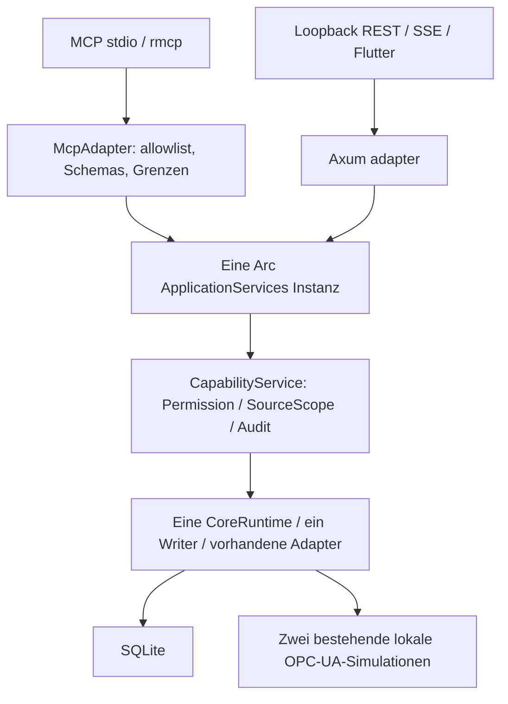

# OIP-006 — Local Native MCP Adapter

Stand: 2026-11-05 (Europe/Berlin). **OIP IS AGENT-FIRST BY DESIGN.** Lokaler Integrationsmeilenstein, keine Produktionsfreigabe.

## Normative Grundlage und SDK

Normativ: [MCP 2026-07-28](https://modelcontextprotocol.io/specification/2026-07-28), insbesondere [Versionierung](https://modelcontextprotocol.io/specification/2026-07-28/basic/versioning), [stdio](https://modelcontextprotocol.io/specification/2026-07-28/basic/transports/stdio), [Tools](https://modelcontextprotocol.io/specification/2026-07-28/server/tools) und [Resources](https://modelcontextprotocol.io/specification/2026-07-28/server/resources). Bei Implementierung tatsächlich online geprüft; keine alten Initialize-Beispiele als aktuelle Norm behandelt.

`rmcp = 3.8.0`, gepinnt, offizielles [Rust-SDK](https://github.com/modelcontextprotocol/rust-sdk), Apache-2.0, MSRV 1.88; Host Rust 1.93.0. Produktfeatures ausschließlich `server`, `transport-io`; keine MCP-HTTP-, WebSocket-, Auth-Cloud- oder Modell-Runtime. Das SDK implementiert Framing, Discovery, Protokollprüfung, Handshake-Kompatibilität, Request-Metadaten, Cancellation und MCP-Ergebnistypen. `schemars 1.2.3` generiert Schemas. `jsonschema 0.46.10` ist ausschließlich Testabhängigkeit, mit deaktivierten Defaultfeatures. Client-/Child-Process-Features des SDK sind ebenfalls Testabhängigkeiten, nicht zusätzliche Produkttransporte.

Die aktuelle Spezifikation verwendet **server/discover und Metadaten pro Request**, keinen Initialize-Handshake. Das SDK unterstützt daneben Legacy-Initialize. Belegt sind `2026-07-28` über Discover und `2025-11-25` über Initialize. Weitere SDK-Versionen werden nicht als separat interoperabilitätsgeprüft behauptet.

## Architektur und kleine notwendige Änderungen



Keine neue Workspace-Crate. `crates/oip-server/src/mcp.rs` und `mcp/transport.rs` sind der Adapter. Er kennt weder SQL noch OPC-UA-Clientoperationen, verwaltet keine Quellen und startet keine Collector. Die 13 Core-Requests, Permissions und ihre Semantik bleiben erhalten. Der Core bekommt ausschließlich optionale `schemas`-Derives mit neutralem schemars; **kein rmcp, Axum oder Flutter**. Ohne dieses Feature bleibt seine bisherige Produktabhängigkeit serde/thiserror.

REST erhielt eine explizit injizierbare Serviceinstanz statt pro Request eine neue Fassade zu erzeugen. Main gibt REST und MCP dieselbe `Arc<ApplicationServices>` und denselben State. Normale REST-Starts behalten ihren bisherigen lokalen Kontext. Im kombinierten MCP/REST-Modus verwendet auch REST die konfigurierte MCP-Autorität; pro HTTP-Aufruf wird eine neue Korrelations-ID erzeugt. Keine Header oder Bodies erteilen Grants. Die bestehenden API-Bodies und SSE-Snapshots bleiben kompatibel. Bei Source-beschränkter Policy sind globale REST-/Snapshot-Reads folgerichtig verweigert.

Am bestehenden Audit-Port ergänzt ein synchroner Drop-Guard den Ausgang `interrupted`, falls eine autorisierte Service-Future aufgegeben wird. Zielquelle wird weiterhin in ApplicationServices aus der registrierten Identität aufgelöst. Normaler Erfolg/Fehler und Mutation-Auditverhalten bleiben unverändert. Keine getrennte MCP-Geschäftsregel.

## Eine Runtime und Datenbank-Ownership

`oip-server --mcp-stdio` besitzt die CoreRuntime im selben Prozess. `--mcp-rest` aktiviert optional den **bestehenden Loopback-REST-Server**, keinen MCP-HTTP-Transport. Ohne diese Option wird kein HTTP-Listener geöffnet. Der MCP-Client besitzt den Prozesslebenszyklus; EOF, Signal oder Transportabbruch stoppen auch REST und den Core. Es gibt keinen Hintergrund-Daemon, keinen HTTP-Proxy und kein Attach an einen schon laufenden Prozess.

MCP verlangt einen **absoluten Datenbankpfad**. Dadurch ändert das Arbeitsverzeichnis eines Client-Launchers nicht still den Datenbestand. Vor SQLite-Initialisierung erwirbt `CoreRuntime::start` eine exklusive OS-Dateisperre auf `<canonical database path>.oip-lock`. Symlink-Aliase werden kanonisiert; Hardlink-Datenbanken werden auf Unix abgewiesen. Die Sperre bleibt bis zum Abschluss des Writer-Drains bestehen. Ein zweiter normaler Core-/MCP-Start auf demselben Bestand wird vor Collectors und Migrationen abgewiesen. Nach sauberem Shutdown oder Prozessverlust gibt das OS die Sperre frei; eine vorhandene Sidecar-Datei ist kein belegter aktiver Besitzer und wird nicht gelöscht.

Dies ist kooperative lokale Ownership, kein Schutz gegen einen OS-Benutzer, der Sperrdateien entfernt oder alte/unabhängige Software verwendet. **Vor Wechsel auf diesen Stand alte Core-Binaries kontrolliert stoppen.** Bestehende fremde Prozesse wurden nicht beendet. Direkte eingebettete `AppState`-/`from_state`-Test-/Hostkompositionen bleiben für ihre Store-Ownership verantwortlich; sie sind kein weiterer CLI-/MCP-Startpfad. Kein Multi-Host-Lease oder verteiltes SQLite-System.

Die erste Sperrvariante auf der SQLite-Datei selbst verursachte auf macOS `DatabaseBusy` und wurde verworfen. Die separate kanonische Sidecar ist durch Doppelstart-, Symlink-, Neustart-, Headless-Crash- und echte MCP-Prozesstests geprüft.

## Tools und Resources

Sechs Tools: `oip_devices_read`, `oip_device_read`, `oip_observations_read`, `oip_sources_read`, `oip_events_read`, `oip_opcua_nodes_read`. Namen, Eingaben und Ausgaben stehen im [Capability-Mapping](oip-mcp-capability-mapping.md). Erfolgreiche `structuredContent` ist der bestehende Core-Umschlag `{type,value}`; für Legacy-Clients liefert das SDK zusätzlich JSON als Textinhalt. Fachfehler verwenden `isError=true` und unveränderte `CapabilityError {kind,code,message}`. Nicht routbare Tools und ungültige Argumente liefern MCP-Protokollfehler. Unbekannte Tools führen keinen Core-Request aus.

Sechs globale JSON-Resources: `oip://v1/core/health`, `/core/liveness`, `/core/readiness`, `/core/queue`, `/system/status`, `/snapshot/current`. Dazu autorisierte registrierte Quellen als `oip://v1/sources/{id}/health`; im Zweiquellenprofil somit acht Ressourcen. Source Health ist bewusst zusätzlich als Resource verfügbar: stabil adressierbares Read-Modell; das Tool erlaubt explizite Source-Queries. Es entsteht keine zweite Implementierung.

Resource-Enumeration fragt die vorhandene SourcesRead-Capability ab. Source-begrenzte Clients sehen nur eingeschriebene erlaubte Quellen. Globale Aggregate werden weder erfunden noch still teilweise gefiltert: sie sind bei `Only` verweigert. Auch direkte URI-Aufrufe durchlaufen die Service-Autorisierung. Resource-Fehler tragen die typisierte Core-Kategorie in JSON-RPC error.data. Antworten sind `application/json`, TTL 0 und private Cache-Scope. Keine Dateisystem-URIs, keine Secrets, keine Resource-Subscriptions oder Replay-Zusagen. Aktualisierung erfolgt durch erneuten autorisierten Read; REST/SSE behalten ihre Resynchronisierung.

## Schemas und Grenzen

Inputs entstehen aus den existierenden Rust-Querytypen mit serde `deny_unknown_fields`. Ausgabe-Schemas werden aus dem bestehenden `CapabilityOutput` erzeugt und auf die jeweilige tatsächliche Variante plus referenzierte Typen reduziert. Keine unabhängig gepflegte Kopie der fachlichen DTOs. Der Operator-Katalog lässt sich aus derselben Adapter-Allowlist generieren:

```sh
cargo run --locked -p oip-server --example mcp_catalog
```

Adaptergrenzen: Source-ID 1–128 sichere ASCII-Zeichen, ID 1–256 UTF-8-Bytes; q/location/folder maximal 256 UTF-8-Bytes. JSON-Schema beschreibt Stringlängen zusätzlich in Zeichen; der Runtime-Bytecheck ist bei mehrbyteigen Eingaben strenger. Null ist nur bei Optional-Feldern erlaubt. Listen statt Strings, unbekannte Felder, Grants/Actor/Timestamps als Toolparameter und unzulässige Nummern werden vor Ausführung verworfen. Nodes: Offset 0–1.000.000, Limit 1–100, Standard 40. REST behält seinen kompatiblen Clamp; MCP lehnt außerordentliche Limits explizit ab. Das ist Transportvalidierung, keine abweichende fachliche Ergebnisregel.

Maximal 16 KiB pro stdio-Zeile (einschließlich Envelope); größere Zeilen werden vom SDK begrenzt verworfen, anschließend können gültige Frames folgen. Syntaktisch nicht lesbares JSON wird entsprechend dem geprüften offiziellen SDK verworfen; es gibt dann keine korrelierbare Antwort. Gültiges JSON mit ungültiger RPC-Form erhält Invalid Request. Keine vollständigen Rohpayloads im Log.

Maximal 16 ausstehende Requests einschließlich noch nicht ausgegebener Antworten. Bei Überlast oder doppelter aktiver Request-ID wird die Verbindung geschlossen und der Core kontrolliert entleert. Keine unbegrenzte Ablehnungsqueue für einen blockierten Leser. Reads haben 15 Sekunden Deadline. Cancelled-IDs reservieren ihr Admission-Slot konservativ bis zu dieser Deadline, weil das SDK abgebrochene Antworten unterdrückt; beim nächsten Admission werden abgelaufene Slots zurückgewonnen. Es gibt keinen abgekoppelten Cleanup-Task. Eine Folge von 16 sofortigen Abbrüchen kann daher das Fenster vorübergehend ausschöpfen und zum definierten Überlast-Shutdown führen.

Core-JSON-Ausgabe maximal 4 MiB. Legacy-Text plus structuredContent können den Wire-Umfang entsprechend vergrößern. Größere Gesamtzustände liefern einen expliziten Limitfehler; Source-Filter/Node-Pagination nutzen. Registry maximal 32 Quellen, Events maximal 100, Node-Seite maximal 100; keine unbegrenzte History-Query. Der Adapter hält keine SQLite-Schreibsperren. Node-Reads verwenden den vorhandenen autorisierten Service, der Messproben über den normalen Writer persistiert; keine Geräte-Schreiboperation.

Ausgabe-Stall: drei Sekunden, danach Verbindung schließen statt einen teilweise geschriebenen Stream weiterzuverwenden. Transport-Close ist auf eine Sekunde begrenzt. Core-Drain folgt der vorhandenen Runtime-Konfiguration; keine neue Zeitgrenze für normalen Betrieb. Auf macOS kann Tokio-stdin einen nicht abbrechbaren Blocking-Read halten. Nach dem Core-Drain begrenzt Main deshalb das Executor-Shutdown-Warten auf zwei Sekunden. Dies ist keine behauptete Join-Garantie für OS-blockierte stdio-Threads; SQLite-Writer-Join und Datenabschluss werden separat berichtet.

## Autorisierung, Audit und Security

`--mcp-policy` ist verpflichtend, strikt typisiert und lokal vom Operator kontrolliert. Keine impliziten Grants. `SimulationControl` in der Policy wird abgewiesen. Actor/Grants/All-Scope aus Toolargumenten oder MCP-clientInfo haben keine Autorität. Das OS und die freigegebene lokale Startkonfiguration bilden die Vertrauensgrenze, **keine produktiv authentifizierte Benutzeridentität**. Keine Tenant- oder Remote-RBAC-Garantie.

Alle gültigen Calls laufen durch die bestehenden Permissions und Source-Scope-Prüfungen. Device-Zuordnung stammt aus der Registry. Auch Snapshot/Health können Source-Scope nicht umgehen. Audit enthält Actor, Capability, autoritative Zielquelle, Entscheid/Ergebnis, Zeitpunkt und Korrelation; der Adapter ergänzt die vertrauenswürdige Source-Scope-Korrelation. Boundary-Rejections veröffentlichen nur statische Capability-/Fehlerklassen mit redigiertem Ziel. Unterbrechungen werden am bestehenden Audit-Port erfasst. Das Audit bleibt ein lokaler, nicht dauerhafter und nicht manipulationssicherer Log.

MCP-Start verwendet einen festen redigierten Logfilter, auch bei `RUST_LOG=trace,rmcp::service=trace`; SDK-Rohpayload-Logging ist deaktiviert. Alle Produktlogs und Shutdown-Berichte gehen im stdio-Modus nach stderr, stdout bleibt ausschließlich MCP. Legacy-REST-Starts behalten den bisherigen stdout-Shutdown-JSON-Vertrag.

Gesperrt: die einzige vorhandene Mutation `simulation_scenario_set` und sämtliche nicht implementierten Registrierungs-, Konfigurations-, Admin-, Shell-, Datei-, OPC-UA-Write-/Methoden- und OT-Aktionen. Kein generisches Execute-/URL-Proxy-Tool. MCP lässt kein eingebettetes `--demo`-Steuerprofil zu; lokale Simulatorprozesse sind unabhängig startbar.

**RUSTSEC-2023-0071 bleibt Produktionsblocker**, ebenso bleiben die dokumentierten Ausnahmen 2023-0089/2024-0449 offen. cargo-deny mit unveränderten Ausnahmen ist keine Behebung. Keine öffentliche MCP-Schnittstelle, Industriehardware, Cloud, Zertifikatsumgehung oder Maschinensteuerung.

Startbefehle, gemessene Performance, ausgeführte Tests, Grenzen und Abschluss-Gates: [OIP-006 Verification](../oip-006-verification.md). Nächste Phase: gesonderte Review-/Security-Abnahme der lokalen Leseschnittstelle und erst danach gezielte Transport-/Identitätsarbeit. Mutationen erfordern zuerst belastbare Identität, dauerhaftes Audit und Wiederholungs-/Freigabesemantik; industrielle Aktuierung zusätzlich ein eigenes OT-Safety-Gate.
