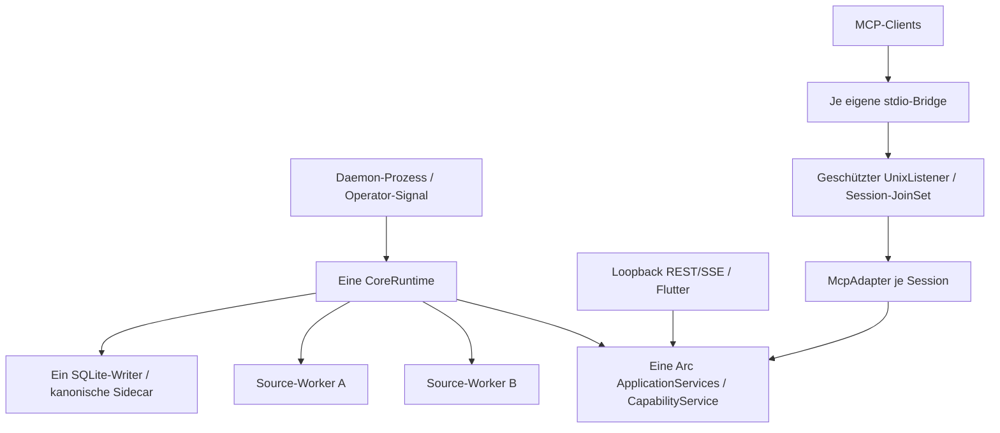

# OIP-007 — Persistent Core Runtime

**OIP IS AGENT-FIRST BY DESIGN.** Lokaler Entwicklungsbetrieb; keine Produktionsfreigabe. Die frühere [OIP-006-Architektur](oip-006-mcp.md) bleibt für den stdio-owned Modus gültig. OIP-007 ergänzt Betriebsarten, keinen zweiten fachlichen Core.

## Audit der Ausgangsarchitektur

1. OIP-006 `main::run` besaß eine `CoreRuntime`. Der stdio-Client startete diesen Prozess. EOF, Transportfehler oder Signal gewannen denselben Shutdown-Select.
2. `CoreRuntime::start/from_state` registriert Quellen und startet je Quelle einen unabhängigen `source_worker` mit eigenem Adapter/Session/Reconnect. Die Runtime besitzt Worker und Freshness-Ticker, `AppState` den begrenzten Writer-Port und dessen Thread.
3. `McpAdapter::serve_with_ct(BoundedTransport(stdin,stdout))` verwendet rmcp. Ein optionaler Axum-Server erhält dieselbe `Arc<ApplicationServices>`. Keine zweite Service-/Ingestion-Implementierung.
4. stdio-EOF beendete MCP, anschließend Worker, Ingestion/Writer und optional REST. Das ist im bisherigen Modus weiterhin die erklärte Semantik.
5. REST und MCP teilen Service und AppState. Fachliche Requests, Permissions, Source-Zuordnung und Audit liegen am vorhandenen CapabilityService-Port.
6. Vor SQLite/Migrationen/Collectors erwirbt `CoreRuntime::start` die exklusive OS-Sperre auf der kanonischen DB-Sidecar. Symlink-Aliase werden kanonisiert, Hardlink-DBs abgewiesen. Das File bleibt bis Writer-Drain gehalten. Kein Multi-Host-Lease oder Schutz gegen einen böswilligen OS-Eigentümer, der Dateien ersetzt.
7. Zu ändern waren Composition/Lifecycle und ein lokaler Transportadapter. Domain, Storage-Schema, fachliche DTOs, API-Verträge und Workspace-Struktur benötigen keine neue Architektur.
8. OIP-006 hatte nur eine stdio-Sitzung mit 16 ausstehenden Requests. Ein zweiter Core auf derselben DB wurde durch Ownership abgewiesen; ein Attach-Transport existierte nicht.
9. Wiederverwendet: CoreRuntime, ApplicationServices, CapabilityService, McpAdapter/Policies/Schemas/Read-Allowlist, BoundedTransport, Axum, Source-Worker und Writer.
10. Neu: geschützte IPC-Startup-Konfiguration, OS-Peer-/Credential-Bindung, begrenzter Session-Owner und Bridge. Keine neue fachliche Capability.

## Ownership und vier Betriebsarten

- **Headless/REST:** bisherige CLI, Runtime bis Operator-Signal, keine MCP-Abhängigkeit.
- **stdio-owned MCP:** bisheriges `--mcp-stdio --mcp-policy ABS`, optional `--mcp-rest`; Client-EOF stoppt weiterhin dessen eigene Runtime. Abwärtskompatibel, kein heimliches Attach.
- **Persistent Daemon:** `--daemon --config ABS --ipc-config ABS`, absoluter DB-Pfad erforderlich. Kein eingebettetes `--demo`, kein stdio-owned MCP und keine Mutations-Policy. Der Daemon läuft im Vordergrund; ein Supervisor ist optional und wird nicht installiert.
- **Bridge:** `--mcp-bridge --ipc-socket ABS --ipc-credential ABS`. Dieser früh abgegrenzte CLI-Pfad kehrt vor CoreConfig, SQLite und Runtime-Start zurück. Nur Transport, keine Collector/Writer/SQL/HTTP-Proxy-Funktion.

Die bestehende komponentenbasierte Lifecycle-Projektion Initializing/Ready/Degraded/Stopping/Stopped/Failed bleibt allein maßgeblich. Es gibt keine zusätzliche Daemon-Fachzustandsmaschine. Quellenfehler degradieren die vorhandene Projektion; Client-Fehler ändern keinen fachlichen Quellenzustand.

## Start und Stop

Daemon: validierte Konfiguration → geschützter IPC-Listener/Ownership → Loopback-HTTP-Bind → bestehende DB-Ownership/Migration/Restore → Source-Worker/Writer/Ticker → gemeinsame Services → REST und IPC-Session-Loop. Fehler vor Runtime-Start lassen keine Collector zurück; bereits vorbereitete Socket-Ressourcen werden über Ownership-Drop bereinigt.

SIGINT/SIGTERM oder unerwarteter globaler Listener-/HTTP-Ausfall beenden die Composition. IPC-Admission stoppt, Session-Kindtokens werden cancelt, tatsächliche SDK-Service-Futures gejoint. Nach acht Sekunden werden verbleibende Session-Tasks ausdrücklich diagnostiziert und abgebrochen. Danach vorhandener Core-Shutdown: Producer stoppen, begrenzte Buffers drainen, Writer-Admission schließen, Transaktionen abschließen und Writer joinen. REST wird anschließend kontrolliert geschlossen; langsame HTTP-Verbindungen haben weiterhin eine separate Drain-Grenze. Ein Client-EOF, Admission-Fehler, ungültiges MCP-Request oder einzelner Source-Ausfall gewinnt **nicht** den globalen Shutdown-Select.

Neu explizit getrennt: ein offline OPC-UA-Server kann CloseSession nicht bestätigen. Die lokale Session darf nur dann als gestoppt gelten, wenn ihr tatsächlicher Event-Task beendet ist. Ein unbestätigtes Remote-Close wird als `opcua_remote_close_unconfirmed` protokolliert und verhindert den nachfolgenden lokalen Queue-/Writer-Drain nicht. Ein nicht beendeter Producer bleibt dagegen ein typisierter Taskfehler; Ingestion-/Persistenzfehler werden nicht herabgestuft. Kein behaupteter sauberer Remote-Session-Abschluss.

## Recovery und Betriebsgrenzen

Der Daemon sammelt auch bei null MCP-/Flutter-Clients. Reconnect einer Bridge erzeugt eine neue Protokollsitzung mit derselben serverseitigen Policy; kein automatisches Replay oder heimliches Übernehmen ausstehender Requests. Eine Client-Sitzung startet niemals einen Core.

Nach Prozessverlust gibt das OS die DB- und IPC-Sidecar-Sperren frei. Das vorhandene Run-Journal markiert einen laufenden alten Run beim Neustart als `interrupted`. Persistierte Werte sind stale, Runtime-Empfangszeiten null und Reachability unknown. Erst echter Adapterempfang macht Daten wieder aktuell. Es gibt weiterhin keinen dauerhaften Ingestion-Spool und keine Rekonstruktion aller während eines Crash verlorenen Samples.

Die IPC-Sidecar speichert die Identität des vom Daemon erzeugten Sockets. Nur ein passender eigener Rest-Socket kann unter exklusiver Sperre als Crash-Rest bereinigt werden. Unbekannte/ersetzte Socket-Dateien werden nicht gelöscht. Ein Crash genau zwischen Bind und bestätigtem Ownership-Record kann bewusst eine manuell zu prüfende Restdatei hinterlassen. Normale fehlgeschlagene Record-Publikation besitzt dagegen einen Rollback-Guard. Keine blinde Unlink-Strategie.

Linux ist architektonisch über Unix-Sockets vorbereitet, hier jedoch nicht nativ ausgeführt. Windows Named Pipes benötigen einen separat getesteten lokalen Transportadapter; der neue Modus verweigert Nicht-Unix statt Unterstützung vorzutäuschen. Headless und bisheriges stdio bleiben getrennte Pfade.

[IPC-/Security-Details](oip-007-mcp-multiclient.md), [ausgeführte Verifikation und Befehle](../oip-007-verification.md), [OIP-008-Vorschlag](oip-008-multi-infrastructure-proposal.md).
